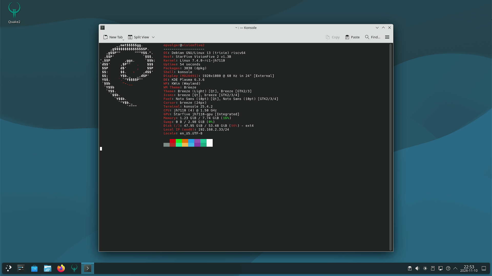
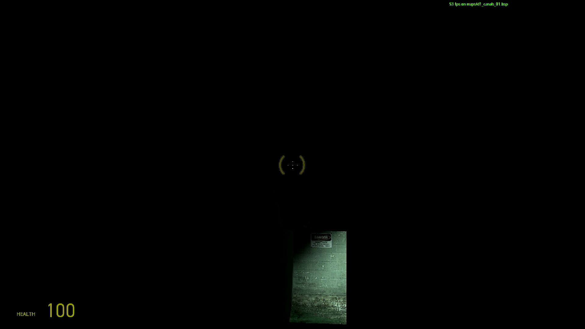
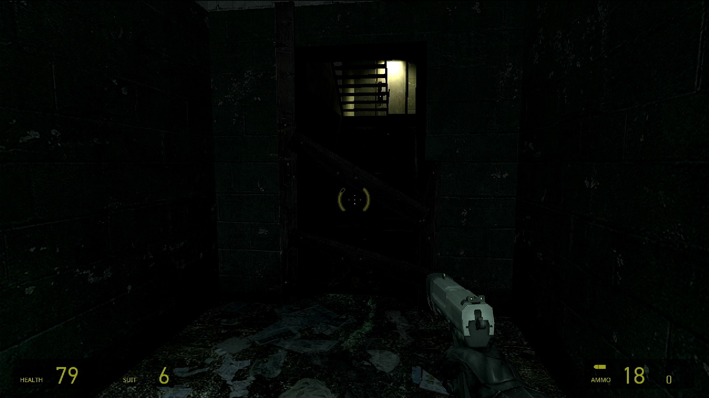

# JH7110 (VisionFive 2): accelerated HDMI on Debian 13

> **For a new Claude Code session:** read this whole file first. Check **Current status** and
> the **Progress log** (newest entry at the bottom). Continue from the first open item in the
> **Plan**. Update this file *while working* (after each step that succeeds or fails), not only
> at the end, so a session that hangs or dies loses no progress.

## Goal

1. HDMI output with GPU acceleration on the StarFive VisionFive 2 (JH7110), running Debian 13
   (trixie).
2. Half-Life 2 (one of the builds in `~/games` on the board) starts and runs on it.
3. A tested **rollback how-to**: return the board to the stock Debian 13 kernel/Mesa packages.

## Rules / working method

- Same setup as `~/code/linux-kernel-jupiter-1`: a mainline kernel plus a patch series, a
  Makefile that checks out, patches and builds `.deb` packages, with the patches kept in this
  project.
- Build on this machine (Fedora x86_64) by **cross-compiling**. If tools are missing, use a
  Docker image with a cross toolchain. **No native builds under QEMU emulation** (far too slow).
- You may install tools on the board for testing HDMI/DRM (`drm_info`, `modetest`, `kmscube`,
  `vulkaninfo`, `glmark2`, etc.).
- Every package we replace must have a documented way back to the Debian package (see
  **Rollback**).
- Keep the stock Debian kernel installed and bootable at all times (GRUB fallback entry).

## Current status

| Part | Status | Notes |
| --- | --- | --- |
| Board reachable (SSH/serial/power) | ✅ | Debian 13.7, running Debian kernel `6.12.74+deb13+1` |
| **Board boots now** | — | open stack `7.4.0-rc1-jh7110` (since 2026-11-11 20:39). Vendor stack: `board-tools/set-boot.sh 6.12.5-vf2` |
| Kernel 7.4-rc1 + patches | ✅ | `7.4.0-rc1-jh7110` boots, `debs/linux-image-7.4.0-rc1-jh7110_7.4.0-rc1-1_riscv64.deb` |
| Display (DC8200 + HDMI) via DRM/KMS | ✅ | fbcon + KDE Plasma Wayland at 1920x1080@60 (llvmpipe), see `shots/phase-a-kde-fastfetch-llvmpipe.png` |
| GPU (IMG BXE-4-32, `drm/imagination`) | ✅ | FW v1.1 boots, `renderD128`; Vulkan 1.2 (`vulkaninfo`) |
| Mesa (PowerVR Vulkan + Zink) | ✅ | Mesa 26.3.0 in /opt; KDE (kwin) composites with "zink Vulkan 1.2 (PowerVR BXE-4-32)", see `shots/phase-b-kde-fastfetch-powervr.png` |
| Half-Life 2 (open stack) | ✅ slow | ToGL build on Zink/PowerVR, Mesa 26.3.0 rev 10: ~3.5 fps (desktop session), ~4.5–5 fps (KMS) |
| **Half-Life 2 (open stack + PowerVR perf fork, phase D)** | ✅ **~26–28 fps** | Mesa main `9a2b374` + ayiejosh perf series + our patches (`mesa-jh7110 26.3.0~git9a2b374+ayie-2`, installed): ~28 fps KMS, ~26 fps KDE fullscreen 1280x720, timedemo 11.75 fps avg (`shots/ayie2-hl2-kwin-fs.png`) |
| **Half-Life 2 (vendor stack, phase C)** | ✅ **18–53 fps** | togles build on Imagination's closed GLES 3.2 + vendor kernel 6.12.5-vf2: `shots/phase-c-hl2-togles-53fps.png` |
| **HDMI audio (open stack, phase E)** | ✅ | kernel `7.4.0-rc1-3` (patches 0040-0042): ALSA card `StarFive-HDMI-Sound-Card`, PipeWire default sink; verified with the HDMI capture card (1 kHz/440 Hz, 48/32 kHz, L/R correct) |
| Rollback how-to tested | ⏳ | |

## Plan

1. [x] Set up the project: git repo, `Makefile`, `scripts/`, `linux-7.4-patches/` (copy the
       structure of `~/code/linux-kernel-jupiter-1`).
2. [x] Kernel 7.4-rc1 (mainline) + patches for the display controller, HDMI and GPU; cross-build
       `.deb`s (a modules + initramfs flavor based on the Debian config).
3. [x] Install next to the Debian kernel, boot it, check: `/dev/dri/card*`, `modetest`, a console
       on HDMI (watch via the UGREEN capture).
4. [ ] GPU: `drm/imagination` loads and its firmware is found (`/lib/firmware/powervr/`).
5. [ ] Mesa: check whether trixie-backports is enough (PowerVR Vulkan driver for BXE-4-32,
       Zink for OpenGL). If not, cross-build Mesa `.deb`s.
6. [ ] Test: `vulkaninfo`, `kmscube`/`vkcube`, `glmark2`; then a desktop/compositor if needed.
7. [ ] Start Half-Life 2.
8. [ ] Write and **test** the rollback how-to.

## Project layout

```text
Makefile                  make checkout-7.4 / config-7.4 / deb-7.4 / export-7.4 (make help)
linux-7.4-patches/        0001-0005 HDMI PHY series v7, 0006-0024 display series v7 (from lore),
                          0025-0028 XPbmtUC errata (Samuel Holland ALTERNATIVE_3 + Bo Gan),
                          0029-0038 PowerVR BXE-4-32 bring-up (domibel, rebased on 7.4-rc1)
                          0039 dw-axi-dmac log level, 0040-0042 HDMI audio (ours, phase E)
mesa/                     Dockerfile + build.sh: Mesa cross-build -> debs/mesa-jh7110_*.deb (/opt)
mesa/patches-26.3.0/      our patches on the 26.3.0 release (rev 1-10)
mesa/prepare-git9a2b374.sh  phase D tree mesa/mesa-git: Mesa main 9a2b374 + fork-ayiejosh-series/
                          (0001-0105 from github.com/ayiejosh/a733-powervr-fex) + patches-git9a2b374/
                          (0006 = upstream zink fix 2f42570a92c, from ayie-4);
                          build: SRCDIR=mesa-git PKGVER=26.3.0~git9a2b374+ayie PKGREV=n mesa/build.sh
scripts/firmware-deb.sh   debs/powervr-firmware-jh7110_*.deb (pinned BXE-4-32 firmware)
configs/debian/           Debian config of the board (7.1.7 backports), base for our config
scripts/kernel-tree.sh    worktree linux-7.4/ of .kernel.git (shallow, tag v7.4-rc1) + git am
scripts/make-config.sh    Debian config -> build/7.4/obj/.config (+ display options, no debug info)
scripts/export-patches.sh commits in linux-7.4/ -> linux-7.4-patches/
board-tools/              power, serial, U-Boot catch, screenshot, set-boot.sh (boot.scr)
debs/                     built packages (not in git)
logs/                     build logs (not in git)
shots/                    HDMI captures for the documentation
```

Kernel release: `7.4.0-rc1-jh7110`; the package installs `/boot/vmlinuz-<rel>` (uncompressed
Image, `KBUILD_IMAGE=arch/riscv/boot/Image`), DTBs in `/usr/lib/linux-image-<rel>/starfive/`;
Debian's initramfs hook makes `/boot/initrd.img-<rel>`.

## Board facts (found during sessions)

- Model: `StarFive VisionFive 2 v1.3B`, DTB `/boot/jh7110-starfive-visionfive-2-v1.3b.dtb`.
- **Boot: U-Boot `bootflow scan` → `/boot.scr` on mmc 0:1 (eMMC root fs).** GRUB/EFI is installed
  but *not* used (there is no grub.cfg). `/boot.scr` is compiled from `/boot.cmd` with `mkimage`.
  Careful: at the start `/boot.cmd` said 7.1.7, but `/boot.scr` (the real one) boots
  **6.12.74+deb13+1**. Use `board-tools/set-boot.sh <release>` to switch (keeps a backup
  `/boot.scr.bak-<old>`).
- Stock boot (6.12.74) as originally in `/boot.scr`; type this in U-Boot by hand to recover:
  ```
  load mmc 0:1 ${kernel_addr_r} /boot/vmlinux-6.12.74+deb13+1-riscv64
  load mmc 0:1 ${fdt_addr_r} /usr/lib/linux-image-6.12.74+deb13+1-riscv64/starfive/jh7110-starfive-visionfive-2-v1.3b.dtb
  load mmc 0:1 ${ramdisk_addr_r} /boot/initrd.img-6.12.74+deb13+1-riscv64
  setenv bootargs 'root=/dev/mmcblk0p1 radeon.si_support=0 radeon.cik_support=0 amdgpu.si_support=1 amdgpu.cik_support=1'
  booti ${kernel_addr_r} ${ramdisk_addr_r}:${filesize} ${fdt_addr_r}
  ```
- RAM 8 GB. No AMD card in the PCIe slot anymore (only the onboard VL805 USB controller).
- SDDM is enabled (graphical.target), sessions: Plasma Wayland (`plasma`) and X11 (`plasmax11`).
  No `/etc/sddm.conf.d/` config at the start.
- Test tools installed on 2026-11-10: `libdrm-tests` (modetest), `drm-info`, `kmscube`,
  `fastfetch`, `mesa-utils`, `vulkan-tools` (remove in the rollback if wanted).
- No `/lib/firmware/powervr/` at the start.
- Kernels already in `/boot`: Debian `6.12.x`, `6.17.13`, `7.0.10+deb13`, `7.1.7+deb13`
  (installed earlier; their origin is not documented yet).
- Root filesystem: 54G, **94% full (~3.5G free)**. Watch this when installing kernels/Mesa.
- Mesa: `mesa-vulkan-drivers` / `libgl1-mesa-dri` `25.2.6-1~bpo13+1` from trixie-backports
  (trixie itself has `25.0.7-2+deb13u1`).
- `~/games` on the board: only `hl2-source`. More builds are on the build machine in
  `~/games` (`hl2-dxvk`, `hl2-wayland-pr`, ...); copy one over if needed. Port notes:
  `/home/opvolger/code/source-engine/port-to-riscv.md`.
- KDE Plasma is already installed (HL2 ran before on an AMD GPU in this board).
- The Debian `7.0.10` and `7.1.7` kernels (backports) may be removed to free space.

## Software

### Kernel

Base: mainline **7.3** (stable). The patches should apply to 7.3 with small changes.

Display patches (provided by the user): **"[PATCH v7 00/19] drm: starfive: jh7110: Enable display
subsystem"** by Michal Wilczynski, 2026-11-06.

- Thread: https://kernelthread.org/t/CGME20261106135849eucas1p242718d72fa1f38e31477210fd9ee30bc@eucas1p2.samsung.com
- lore: https://lore.kernel.org/all/20261106-jh7110-clean-send-v7-0-68f7ea9913db@samsung.com/
- **Based on v7.4-rc1**, not 7.3. Dependencies:
  - PHY series "phy: Add the StarFive JH7110 Innosilicon HDMI PHY" v7:
    https://lore.kernel.org/all/20261106-jh7110-inno-hdmi-phy-v7-0-d49368303800@samsung.com/
  - clk patch `af384d6e0573` (merged in v7.4-rc1): backport this to 7.3.
- Contents: inno-hdmi bridge refactor + fixes, DT bindings, `soc: starfive` hdmi/vout subsystem
  drivers, JH7110 HDMI bridge driver, DTS update.
- External test write-up: https://big-grey.co.uk/2026/01/26/testing-starfive-jh7110-display-controller-patches/

What 7.3 already has (checked in `~/code/linux-kernel-jupiter-1/linux-7.3-vanilla`): the
Verisilicon DC driver (`drivers/gpu/drm/verisilicon/`) and `drivers/gpu/drm/bridge/inno-hdmi.c`.

**GPU (BXE-4-32): not in mainline.** 7.3 has no `gpu@` node in `jh7110.dtsi` and no JH7110 or BXE
compatible in `drm/imagination`. The kernel docs list BXE-4-32 as unsupported, and Mesa's
`imagination` Vulkan driver does not support it either (as of 2026-11; to be verified). This
display series gives **KMS/HDMI only, no 3D acceleration**.

### GPU (phase B): leads found on 2026-11-10 (research by a subagent, still to verify)

- **domibel (Dominique Belhachemi)** got the BXE-4-32 running on mainline drm/imagination:
  guide https://github.com/domibel/visionfive2_gpu_bringup ; kernel https://github.com/domibel/linux
  - branch `powervr_on_jh7110_visionfive2_v7.3-rc5` (11 commits on v7.3-rc5): GPU node in
    jh7110.dtsi (`starfive,jh7110-gpu`, `img,img-bxe-4-32`, `dma-noncoherent`), extra
    clocks/reset, `pvr_check_gpu_supported()` hack, Icenowy's "power up rascal+dust via
    RGX_CR_POWER_EVENT" and fixes for firmware teardown and the VM.
  - branch `jh7110_dc8200_hdmi_v7.3-rc5`: display series + **Bo Gan's XPbmtUC** RISC-V errata
    series (uncached mappings via emulated Svpbmt, needed on the non-coherent JH7110), lore
    `20260316060328.1173634-1-ganboing@gmail.com`, plus Samuel Holland's ALTERNATIVE_3.
  - "sifive_ccache: Add StarFive JH7110 SoC support" (domibel): reportedly already in mainline.
  - Config hints: `DRM_POWERVR=m`, `STARFIVE_STARLINK_CACHE=y`, `RISCV_NONSTANDARD_CACHE_OPS=y`,
    the SiFive errata options, `cma=128M` or more.
- Firmware `powervr/rogue_36.50.54.182_v1.fw` is not in linux-firmware; get it from
  https://gitlab.freedesktop.org/imagination/linux-firmware/-/raw/powervr/powervr/rogue_36.50.54.182_v1.fw
- Mesa **26.3** (pvr Vulkan + Zink): Vulkan 1.2, Zink OpenGL 3.2 core / GLES 3.1. Environment:
  `PVR_I_WANT_A_BROKEN_VULKAN_DRIVER=1 MESA_VK_DEVICE_SELECT=1010:36054182`. Debian 13 /
  backports (25.2) is too old, so we need to build Mesa ourselves.
- Vendor fallback (phase C): starfive-tech/linux `JH7110_VisionFive2_6.6.y_devel` / `6.12.y_devel`;
  blobs in github.com/starfive-tech/soft_3rdpart `IMG_GPU/out/img-gpu-powervr-bin-1.19.*.tar.gz`
  (GLES/Vulkan, probably **no desktop GL**, so HL2 would be hard).
- Other operating systems (FreeBSD, Haiku, ...): nothing found for this GPU.

### Mesa

First try Debian 13 backports (already installed: 25.2.6). Only build Mesa ourselves if
backports lacks support for the JH7110 GPU.

### Other software

Anything else that is needed (firmware, DTB, tools) gets the same patch-and-package setup.

## Controlling the hardware

### Power on/off

Home Assistant; the token is in `/home/opvolger/home-assistant.txt` (do not copy it into this
file or into git).

```bash
TOKEN=$(cat /home/opvolger/home-assistant.txt)
URL=http://192.168.2.202:8123/api/services/switch
curl -X POST -H "Authorization: Bearer $TOKEN" -H "Content-Type: application/json" \
  -d '{"entity_id":"switch.zolder_sonoff_plug_1"}' $URL/turn_on     # or turn_off / toggle
```

### SSH

`ssh opvolger@192.168.2.33`: no password, passwordless `sudo`. You may install kernels, Mesa and
other packages yourself as needed for the goal.

### Serial console (U-Boot and Linux console)

`/dev/ttyUSB0`, 115200 baud. U-Boot commands can be entered here.

### TFTP (network boot from U-Boot)

A TFTP server runs in Docker on this machine (container `tftp`). If it has crashed, you may
restart it:

```bash
docker run -d --name tftp --network host -v $(pwd):/var/tftpboot pghalliday/tftp
```

Useful when a kernel hangs completely: boot a test kernel over the network from U-Boot without
touching the eMMC.

### Helper scripts (`board-tools/`, copied from the jupiter project)

- `board-tools/power.sh on|off|toggle|state`: shut down cleanly first (`ssh ... sudo poweroff`).
- `python3 -I board-tools/catch.py ' ' 60`: run it right after a reboot; it spams keys and stops
  U-Boot autoboot (prompt `StarFive #`).
- `python3 -I board-tools/ser.py <secs> 'cmd1' 'cmd2'`: send commands, e.g. `'boot'`.
- `board-tools/screenshot.sh shots/x.png`: grab an HDMI frame.

Verified 2026-11-10: power state ✅, HDMI capture ✅ (`/dev/video2`, UGREEN), reboot + U-Boot
interrupt ✅ (U-Boot 2025.07-rc3, `bootcmd=bootflow scan`), `dhcp` in U-Boot ✅, `boot` back to
Linux ✅. TFTP ✅ after the user ran `sudo firewall-cmd --add-service=tftp`. This is **deliberately not
permanent** (the user opens it per session for safety on other networks). If TFTP times out at
`Loading:`, ask the user to run that command again. Do not suggest `--permanent`. Build machine
IP: `192.168.2.34`. In U-Boot: `dhcp` sets `serverip` to the router (.254), so run
`setenv serverip 192.168.2.34` **after** `dhcp`; send U-Boot commands one per `ser.py` call
(they get garbled when sent while `dhcp` is still running). Example load: `tftpboot 0x44000000 <file>`.

**Power cycle:** a powerstation sits behind the plug and buffers power. After `poweroff`, **5 s off
is not enough** (the board stays dead). **60 s off works.** Do: `ssh ... sudo poweroff`, wait about
20 s, `power.sh off`, wait 60 s, `power.sh on`. Don't `pkill -f` with a pattern that matches your
own shell command.

### Watching the HDMI output (UGREEN capture)

An HDMI capture device is connected to this machine (`/dev/video*`; which node is still to be
`/dev/video2` "UGREEN HDMI Capture"; the script looks it up by name). Grab a frame to see what the board shows on HDMI.

## Phase A result: KDE on HDMI without GPU (2026-11-10 21:47) ✅


Changes on the board needed for the KDE session (all in their own files, delete to undo):

- `/etc/sddm.conf.d/50-jh7110.conf`: `GreeterEnvironment=QT_QUICK_BACKEND=software` (the SDDM
  greeter `sddm-greeter-qt6` crashes with SIGSEGV in `QSGRenderThread` on llvmpipe; it also did that
  on 7 Nov, before this project) plus `[Autologin] User=opvolger Session=plasma` (Wayland).
- `~/.config/plasma-workspace/env/jh7110-kwin.sh`: `export KWIN_DRM_NO_AMS=1`. With atomic
  modesetting kwin's TEST_ONLY commit fails with EINVAL ("Atomic modeset test failed! Invalid
  argument"), and with drm.debug=0x16 nothing is logged: the state gets connector 42 + CRTC 40 + CRTC
  50 and is then cleared without `atomic_check`, so a property is rejected while being set. With
  legacy KMS it works. Root cause still to find (verisilicon driver; candidate: a CRTC/plane
  property kwin sets).
- `~/.config/autostart/jh7110-fastfetch.desktop`: Konsole with fastfetch (for the screenshot).
- Small green specks are scattered on the screen: probably cache lines of the non-coherent
  framebuffer (see the dri-devel thread "drm: verisilicon: support non-coherent DMA framebuffers").
- Other boot remarks on 7.4: `end1` (2nd ethernet) "Failed to reset the dma" (unused port);
  `CCACHE: DataError` once at boot; `i2c i2c-7: of_i2c: modalias failure ... controller/ports`
  (harmless, the DDC bus works: EDID is read).

## Phase B result: KDE on the PowerVR GPU (2026-11-10 22:53) ✅



kwin: `OpenGL renderer string: zink Vulkan 1.2(PowerVR B-Series BXE-4-32 MC1 (IMAGINATION_OPEN_SOURCE_MESA))`,
`OpenGL version string: 3.2 (Core Profile) Mesa 26.3.0` (`qdbus6 org.kde.KWin /KWin supportInformation`).
The green specks of the llvmpipe/dumb-buffer setup are gone.

How the rendering is wired (important for later sessions):

- The DRM card numbers change per boot (powervr vs verisilicon load order). Always use
  `/dev/dri/by-path/platform-29400000.display-card` (DC8200) and
  `/dev/dri/by-path/platform-18000000.gpu-{card,render}` (PowerVR).
- kwin only uses the display card (`KWIN_DRM_DEVICES=<display-card>`); kwin ignores the PowerVR
  card (no KMS outputs). EGL/GBM on the display card loads driver name `verisilicon` →
  `/opt/mesa-jh7110/lib/dri/verisilicon_dri.so` (symlink to libdril_dri.so) → gallium has no
  `verisilicon` driver → **kmsro** fallback → **Zink renderonly** on the PowerVR Vulkan device,
  scanout buffers are dumb (CMA) buffers on the display card.
- `MESA_LOADER_DRIVER_OVERRIDE=zink` must **not** be set for kwin (then Zink opens the display
  card directly, finds no Vulkan device for it and falls back to softpipe).
- `kwin_wayland` has file capability `cap_sys_nice=ep` → glibc secure mode → `LD_LIBRARY_PATH`
  ignored → Debian libgbm + our backend → "libgallium-26.3.0.so: cannot open". Removed with
  `sudo setcap -r /usr/bin/kwin_wayland` (undo: `sudo dpkg-reconfigure kwin-wayland`).
  `libcap2-bin` was installed for getcap/setcap.
- Session environment: `~/.config/plasma-workspace/env/jh7110-mesa.sh`:
  ```sh
  . /opt/mesa-jh7110/env.sh
  unset MESA_LOADER_DRIVER_OVERRIDE
  export KWIN_DRM_DEVICES=/dev/dri/by-path/platform-29400000.display-card
  ```
  plus `jh7110-kwin.sh` (`KWIN_DRM_NO_AMS=1`, still needed).
- Firmware deb rev 2 has an initramfs hook (powervr probes from the initramfs at ~8 s).

## Performance log (HL2 ToGL build, `d1_canals_01` start, Mesa GALLIUM_HUD fps)

Measured with `board-tools/hl2-fps.sh` (kwin session) or the same game run with
`SDL_VIDEODRIVER=kmsdrm` and SDDM stopped ("KMS", no compositor). Approximate values.

| Setup | fps | Notes |
| --- | --- | --- |
| kwin, 1280x720, Mesa rev 5 | ~2.0 | "slideshow" |
| kwin, 640x480, Mesa rev 5 | ~2.5 | resolution hardly matters → not fill-rate bound |
| KMS (no kwin), 1280x720, Mesa rev 5 | 3.8 | kwin itself costs a lot of GPU (see below) |
| KMS, 1280x720, `+mat_queue_mode 0` | 3.8 | material system threading is not the issue |
| KMS, 1280x720, Mesa rev 7 (SCALED vertex formats) | 4.5 | u_vbuf CPU vertex conversion gone |
| KMS, 1280x720, rev 8 (64 MiB initial free list) | 4.5 | parameter buffer size is not the issue (patch 0006 dropped again) |
| KMS, 640x480, rev 8 | 12.4 | fps scales with pixel count → fragment-shader bound |
| KMS, 1280x720, rev 8, `+mat_picmip 2` | 4.5 | texture size/bandwidth not the issue |
| KMS, 1280x720, rev 8, `-dxlevel 81` | 1.6 | worse (more passes); note: `-dxlevel` writes `videoconfig_linux.cfg` |
| KMS, 1280x720, rev 9 + `PVR_NO_ROBUST_BUFFER_ACCESS=1` | **5.0** | +11%: no bounds-checked UBO loads in every shader |
| kwin 1920x1080 desktop, HL2 window 1280x720, rev 10 (no-robust, blur/contrast off) | 1.8 | kwin + plasmashell keep the GPU busy |
| kwin **1280x720 desktop**, HL2 windowed 1280x720, rev 10 | 2.5 | |
| kwin **1280x720 desktop**, HL2 `-fullscreen` 1280x720, rev 10 | **3.5** (2–4.3) | best in the desktop session so far |

Other measurements (Mesa rev 6/7):

| Test | Result |
| --- | --- |
| glmark2 windowed in kwin (800x600) | 3–6 fps per scene |
| glmark2 `--off-screen` 1920x1080, display **on** (kwin compositing) | clear 19, build 13 fps |
| glmark2 `--off-screen` 1920x1080, display **off** (kwin idle) | clear 193–216, build 78–91 fps |
| es2gears in kwin (Zink client) / (llvmpipe client) | ~2 / ~1.5 fps → kwin's repaint rate is the limit |
| es2gears in kwin after unloading blur + contrast effects | 3.4–4.4 fps |
| vkcube (Vulkan WSI) in kwin, FIFO / immediate | 2.85 / 35 fps |
| kmscube on KMS (GBM → kmsro → Zink → dumb buffer) | ~93 fps → the KMS/scanout path itself is fine |

Findings, in order of discovery:

1. **kwin compositing is very expensive on this GPU** (~150 ms GPU per kwin frame, even for a tiny
   client); blur/contrast effects roughly double it. With the display off (DPMS) everything else is
   ~10x faster. Not fixed yet; kwin's GL path needs investigating (or another compositor, or HL2 on KMS).
2. **u_vbuf**: HL2 uses `UBYTE4`/`SHORT2/4` vertex data = `*SCALED` vertex formats, which the PowerVR
   driver didn't expose → Mesa converted vertex buffers on the CPU for every draw (GPU sync + uncached
   reads). Fixed with `mesa/patches-26.3.0/0005-pvr-scaled-vertex-formats.patch` (rev 7): +18%.
3. Per HL2 frame on KMS (rev 7): ~4 submits, ~26 new GPU BOs (control streams, `pvr_bo_alloc` per 4 KB
   CSB block + VM map/unmap), ~125 ms GPU time, ~75 ms CPU time, *not overlapping* (ToGL's
   `CPersistentBuffer::BlockUntilNotBusy` → `glClientWaitSync`, and pvr waits on the CPU for the
   previous job before every submit: `pvr_clear_last_submits_syncs`). System is ~93% idle.
4. Not the cause (tested): GPU runtime PM (`power/control=on`), CPU governor (schedutil vs performance),
   SPM scratch buffer reuse (patch 0004 kept, no measurable effect), material system threading.
5. SDL `kmsdrm`: SDL's `MODE_SETCRTC` to 1280x720 fails with EINVAL (no kernel log; modetest *can* set
   1280x720), so every page flip of the 1280x720 buffer fails with `ENOSPC` (fb smaller than the
   1920x1080 mode): frames are rendered but not shown → KMS runs are measurements only. One KMS
   experiment (HL2 under strace) ended in a hang + hardware watchdog reset of the board (02:14).
6. GPU job timing (kernel tracepoints `gpu_scheduler:drm_sched_job_run/done`, see
   `board-tools/hl2-kms-fps.sh`): one fragment job of ~170-190 ms per HL2 frame at 720p (the main scene).
   PCO shader stats (`PCO_DEBUG_PRINT=fs,stats`): HL2 fragment shaders are 400-1000 instruction groups
   (robust on) / median 277, max 636 (robust off), still ~22 `ld` of constants from memory per pixel
   (GL uniforms live in a UBO; not promoted to shared registers) → compiler work, not done.
7. **Zink enables every supported Vulkan feature**, incl. `robustBufferAccess`, so the PowerVR
   compiler bounds-checks every UBO/SSBO access. Mesa patch 0007 adds `PVR_NO_ROBUST_BUFFER_ACCESS`,
   set in `/opt/mesa-jh7110/env.sh` from rev 10 on.
8. In the KDE session, **kwin (DRM client 8) and plasmashell (client 39) render all the time**, even on
   an idle desktop (~14 GPU jobs/s each, jobs of 100-240 ms at 1920x1080; one plasmashell window
   re-renders every ~0.5 s). Lowering the desktop resolution to 1280x720
   (`kscreen-doctor output.HDMI-A-1.mode.1280x720@60`, undo: `...mode.1920x1080@60`) makes es2gears go
   from ~2.6 to 11-35 fps and HL2 fullscreen from 1.8 to ~3.5 fps.
9. kwin blur/contrast effects disabled in `~/.config/kwinrc` (`[Plugins] blurEnabled=false,
   contrastEnabled=false`; backup `~/.config/kwinrc.bak-jh7110`).

Kept (fastest so far, as asked): **phase D: `keep/mesa-jh7110_26.3.0~git9a2b374+ayie-2_riscv64.deb` is now the
fastest open-stack Mesa (see *Phase D result*).** Before that: `keep/` holds kernel `7.4.0-rc1-2`, firmware `-2`, Mesa rev 5 (first
stable) and **Mesa rev 10 (fastest: patches 0001-0005 + 0007, no-robust in env.sh)**.

## Phase E result: HDMI audio on the open stack (2026-11-12 00:35) ✅

The mainline Innosilicon HDMI bridge only did video; its audio registers were defined but unused,
and the DT had no HDMI sound card. Our patches (kernel package `7.4.0-rc1-3`, copy in `keep/`):

- `0040 drm/bridge: inno-hdmi: Add HDMI audio support`: DRM bridge HDMI audio callbacks
  (`DRM_BRIDGE_OP_HDMI_AUDIO`, the bridge connector registers the generic `hdmi-codec`); sample
  rate (reg 0x37), I2S lanes/mode (0x38), N/CTS from `drm_hdmi_acr_get_n_cts()` (0x3f-0x47, CTS
  from software, 0x35 bit 7) on prepare and after every mode set, mute via AV mute (0x05 bit 1),
  audio infoframe through the AAI packet buffer. Only for platforms with `plat_data->audio`.
  Kconfig: `DRM_INNO_HDMI` selects `DRM_DISPLAY_HDMI_AUDIO_HELPER` and `SND_SOC_HDMI_CODEC`.
  Register sequence taken from the vendor driver `drivers/gpu/drm/verisilicon/starfive_hdmi_audio.c`.
- `0041 drm/bridge: jh7110-inno-hdmi: Enable HDMI audio` (`.audio = true`).
- `0042 riscv: dts: starfive: visionfive-2: Add HDMI audio`: `simple-audio-card`
  "StarFive-HDMI-Sound-Card" (`i2stx0` → `&hdmi_controller`, `#sound-dai-cells`), `i2stx0` enabled,
  GPIO 4 muxed as `GPI_SYS_MCLK_EXT` (the 12.288 MHz MCLK that dwc-i2s selects).
- `scripts/make-config.sh`: `SND_DESIGNWARE_I2S`, `SND_SIMPLE_CARD` as modules.

Limits: mainline dwc-i2s offers I2S TX0 with 2 channels at 32/48 kHz only (44.1 kHz gets resampled
by ALSA plug/PipeWire). PipeWire's default sink on the board is now
`alsa_output.platform-sound-hdmi.stereo-fallback` (undo: `pactl set-default-sink
alsa_output.platform-sound.stereo-fallback` = the 3.5 mm jack).

Test: `board-tools/hdmi-audio-test.sh [freq] [rate]` plays a sine on the board's HDMI card and
records the UGREEN capture card's audio input (only that device; its ALSA capture switch
"Digital In" starts **off** and records silence until `amixer -c Capture sset 'Digital In' cap`).
Results: 1000 Hz @ 48 kHz and 440 Hz @ 32 kHz PASS on both channels (rms ~11500), left-only tone
→ left 16708 / right 1.7. The user also heard it on the monitor speakers.

Video: HL2 `+timedemoquit bench` (fullscreen 1280x720, ToGL/Zink, Mesa ayie-2, game sound on
HDMI) recorded through the capture card (MJPEG 1280x720@30 + audio → H.264/AAC):
`logs/hl2-timedemo-open-stack-hdmi-audio.mkv` (8:46, 228 MB, not in git), still
`shots/phase-e-hl2-timedemo-hdmi-audio.png`. Timedemo with sound: **5449 frames in 446.9 s = 12.19 fps**;
audio level present over the whole run (rms per 30 s 590-3027 during play).

Upstream: missing for a submission: `#sound-dai-cells` in the
`starfive,jh7110-inno-hdmi-controller` binding, and `Signed-off-by` (to be added by the user).

## Phase D result: open stack ~6x faster with the PowerVR perf fork (2026-11-11 22:40) ✅

Mesa main `9a2b374` + patches 0001-0105 of the performance series of
[ayiejosh/a733-powervr-fex](https://github.com/ayiejosh/a733-powervr-fex) (written for the BXM-4-64
in the Allwinner A733; copied to `mesa/fork-ayiejosh-series/`, source commit in `SOURCE-COMMIT`) + our
patches in `mesa/patches-git9a2b374/` (0001 dril/verisilicon, 0003 double free, 0005 SCALED vertex
formats, 0007 no-robust option, and 0002 ported: one shared RT dataset per render size on top of the
fork's dataset reuse list). Kernel unchanged (`7.4.0-rc1-jh7110`). Package
`mesa-jh7110_26.3.0~git9a2b374+ayie-2` (installed, copy in `keep/`).

| Setup (HL2 ToGL, `d1_canals_01` start, 1280x720) | fps | slowest GPU job | Notes |
| --- | --- | --- | --- |
| KMS, Mesa 26.3.0 rev 10 (baseline, same session) | 4.45 | 223 ms | |
| KMS, fork rev ayie-1 (without our 0002) | — | — | `ZINK: vkEndCommandBuffer failed (VK_ERROR_INITIALIZATION_FAILED)` = FW heap ENOSPC again; the fork only reuses *freed* datasets |
| **KMS, fork rev ayie-2** | **28.5** | **34 ms** | 6.4x rev 10 |
| KMS, ayie-2 with robust buffer access on (`PVR_NO_ROBUST_BUFFER_ACCESS=0`) | 27.9 | 35 ms | 0007 now only ~2% (fork tests descriptors at draw time) |
| **KDE fullscreen, desktop 1280x720, ayie-2** | **25.9** (median) | | picture correct, `shots/ayie2-hl2-kwin-fs.png` |
| `+timedemo bench`, KDE fullscreen, ayie-2 | **11.75 avg** | | 5449 frames in 463.9 s, 2 complete runs (rev 4/5 never finished) |

Start: app menu "Half-Life 2 (PowerVR Zink, open stack)" → `~/games/hl2-source-togl/run-hl2.sh`
(fullscreen 1280x720, refuses to run on another kernel than `*-jh7110`; log `~/hl2-run-togl.log`;
menu entry `~/.local/share/applications/hl2-source-togl.desktop`).

Notes:
- With the fork, Zink reports OpenGL **2.1** instead of 3.2 compat: `9a2b374` predates upstream's
  `VK_EXT_transform_feedback` for pvr (in 26.3.0). ToGL only needs 2.1 + extensions. The fork has
  its own transform-feedback port (series 0270-0294) if GL 3.x is ever needed.
- The driver now reports **Vulkan 1.3**, but the DXVK build of HL2 still can't run: DXVK needs
  `dualSrcBlend`, which the BXE-4-32 driver does not offer (`Skipping: Device does not support
  required feature 'dualSrcBlend'`).
- **ayie-3 = ayie-2 + later fork patches 0300-0302 (pvr/wsi fixes) and 0384-0386 (pco: one DITR per
  shader, DITR fence replacement, select folding)**: applied with `git am --3way` (local branch
  `try-later` in `mesa/mesa-git`) and built fine, but **hung the board 2 out of 2 times** within the
  150 s KMS run (watchdog reset, no kernel message). Not bisected; most likely the pco changes. Board
  is back on ayie-2.
- One **hard hang + watchdog reset** ~40 s into the first timedemo run (no kernel message; audio had
  just started). Two later full runs and all 150 s runs were fine. A similar hang happened once with
  rev 10 (02:14), so it is not clearly caused by the fork.
- `/dev/dri/renderD128` is only accessible to the user while a seat session (SDDM/KDE) is active;
  with SDDM stopped use `sudo` (vulkaninfo then reports "Failed to detect any valid GPUs").

## Phase C result: HL2 at ~53 fps on the vendor stack (2026-11-11 03:45) ✅




Second map `d1_canals_02` (tunnel looking out to a lit area): **18 fps**
(`shots/phase-c-hl2-canals02.png`); its first load took ~7 min (shader compilation).
App menu: "Half-Life 2 (PowerVR GLES, vendor kernel)" → `~/games/hl2-source-togles/run-hl2.sh`
(refuses to start on another kernel).

`cl_showfps 1`: **53 fps on maps/d1_canals_01.bsp** at the same spot where the open stack does
~3.5 fps (session) / ~5 fps (KMS), fullscreen 1280x720 in the KDE Plasma session. KDE itself
composites on the closed driver too (kwin: `OpenGL ES 3.2 build 1.19@6345021`, es2gears 60 fps =
vsync). Loading a map takes ~3-4 min the first time (the closed compiler compiles all shaders);
a `+timedemo bench` run was therefore very slow and was stopped after 15 min (no number).

What runs (board, all selectable/undoable):

| Piece | Where |
| --- | --- |
| kernel `6.12.5-vf2` (StarFive `JH7110_VisionFive2_6.12.y_devel`, starfive_visionfive2_defconfig + Debian bits, 2 build fixes for GCC 16/make 4.4 committed in `linux-vf2-6.12/`) | `debs/linux-image-6.12.5-vf2_6.12.5-1_riscv64.deb`, boot with `board-tools/set-boot.sh 6.12.5-vf2` |
| closed userspace DDK 1.19.6345021 + firmware + initramfs hook | `debs/img-gpu-jh7110_1.19.6345021-2_riscv64.deb` → `/opt/img-gpu`, `/lib/firmware/rgx.*` |
| StarFive Mesa 22.1.3 (pvr DRI driver, Wayland+GBM, GLES only) | `debs/mesa-pvr-jh7110_22.1.3-1_riscv64.deb` → `/opt/mesa-pvr` (`mesa-pvr/build.sh`) |
| session env | `~/.config/plasma-workspace/env/jh7110-mesa.sh` picks the stack by `uname -r`; for `*-vf2`: `. /opt/mesa-pvr/env.sh; MESA_LOADER_DRIVER_OVERRIDE=pvr KWIN_COMPOSE=O2ES` |
| HL2 GLES build | `~/games/hl2-source-togles/` (from `~/code/source-engine`, `VARIANT=togles scripts/riscv64/build.sh --togles`), start: `. /opt/mesa-pvr/env.sh; MESA_LOADER_DRIVER_OVERRIDE=pvr SDL_VIDEODRIVER=wayland ./hl2_launcher -game hl2 -fullscreen -w 1280 -h 720` |

Back to the open stack: `board-tools/set-boot.sh 7.4.0-rc1-jh7110` + reboot (the env files switch
automatically). Back to stock Debian: see Rollback (now also purge `img-gpu-jh7110`,
`mesa-pvr-jh7110`, `linux-image-6.12.5-vf2`).

## Phase C (vendor stack) — plan, started 2026-11-11 02:55

Why: with the open stack HL2 is stuck at ~3.5 fps (session) / ~5 fps (KMS): the young PCO shader
compiler makes HL2 fragment shaders 10-20x bigger than the originals, and kwin/plasmashell eat GPU
time. Imagination's closed driver has a mature compiler. The open stack stays installed; the vendor
stack is added next to it and selected with `board-tools/set-boot.sh <release>`.

Pieces (all to be kept out of Debian's paths, so the rollback stays simple):

1. **Kernel**: github.com/starfive-tech/linux branch `JH7110_VisionFive2_6.12.y_devel` (tag
   `JH7110_VF2_6.12_v6.0.0`, commit 4cecf169), fetched into `.kernel.git` as `starfive/vf2-6.12`.
   Needs the img-rogue `pvrsrvkm` driver (1.19) + vendor display driver; build as a .deb with the
   Debian config like our 7.4 kernel.
2. **GPU userspace blobs**: github.com/starfive-tech/soft_3rdpart `IMG_GPU/out/img-gpu-powervr-bin-1.19.6345021.tar.gz`
   (GLES1/2/3, Vulkan `libVK_IMG`, OpenCL, `libsrv_um`, `libpvr_dri_support`, firmware). Install into
   `/opt/img-gpu` (NOT /usr/lib: Debian's glvnd libGLESv2 would be overwritten).
3. **Vendor Mesa**: StarFive buildroot `package/mesa3d` = Mesa **22.1.3** + ~60 patches incl.
   `0001-Add-PVR-Gallium-driver.patch` (pvr DRI driver on top of libpvr_dri_support) → EGL/GBM/Wayland
   for kwin and GLES for apps. Cross-build in the mesa docker image → `/opt/mesa-pvr`.
4. **HL2 with the GLES backend**: the source-engine fork has `--togles`; build started 02:50:
   `VARIANT=togles scripts/riscv64/build.sh --togles` → `~/code/source-engine/install-riscv64-togles/`.
   Can also be tested on the open stack (Zink GLES 3.1) as a comparison.

## Rollback to stock Debian 13

Debian's own Mesa packages (trixie-backports 25.2.6) were **never replaced**: our Mesa lives in
`/opt/mesa-jh7110` and is only used where `/opt/mesa-jh7110/env.sh` is sourced. So the rollback is:
the stock kernel back in `/boot.scr`, our three packages purged, and our config files removed.

**Script:** `board-tools/rollback.sh` (dry run; `board-tools/rollback.sh --yes` executes it), then
`ssh opvolger@192.168.2.33 sudo systemctl reboot` and check `uname -r` = `6.12.74+deb13+1-riscv64`.

Everything the project changed on the board, and how to undo it by hand:

| Change | Undo |
| --- | --- |
| `/boot.scr` boots `7.4.0-rc1-jh7110` (written by `board-tools/set-boot.sh`) | `sudo cp /boot.scr.bak-6.12.74+deb13+1-riscv64 /boot.scr` (the original boot.scr), or `board-tools/set-boot.sh 6.12.74+deb13+1-riscv64` |
| `/boot.cmd` overwritten (originally it pointed to 7.1.7, it was not what `boot.scr` contained) | the original text is in `board-tools/rollback.sh` |
| package `linux-image-7.4.0-rc1-jh7110` | `sudo apt-get purge linux-image-7.4.0-rc1-jh7110` |
| package `powervr-firmware-jh7110` (+ initramfs hook; initramfs of all kernels rebuilt) | `sudo apt-get purge powervr-firmware-jh7110` (postrm rebuilds the initramfs again) |
| package `mesa-jh7110` (`/opt/mesa-jh7110`, `/usr/local/bin/mesa-jh7110-run`) | `sudo apt-get purge mesa-jh7110` |
| `/etc/sddm.conf.d/50-jh7110.conf` (software greeter + autologin Plasma Wayland) | `sudo rm /etc/sddm.conf.d/50-jh7110.conf` |
| `/etc/sysctl.d/50-jh7110-printk.conf` (`kernel.printk = 4 4 1 7`) | `sudo rm /etc/sysctl.d/50-jh7110-printk.conf` |
| `~/.config/plasma-workspace/env/jh7110-kwin.sh`, `jh7110-mesa.sh` | `rm` them |
| `~/.config/autostart/jh7110-fastfetch.desktop` | `rm` it |
| `kwin_wayland` file capability `cap_sys_nice` removed | `sudo dpkg-reconfigure kwin-wayland` |
| test tools installed: `libdrm-tests drm-info kmscube fastfetch mesa-utils vulkan-tools libcap2-bin inxi` | optional: `sudo apt-get purge ...` |
| `~/.config/kwinrc` blur/contrast disabled | `cp ~/.config/kwinrc.bak-jh7110 ~/.config/kwinrc` |
| desktop resolution 1280x720 (kscreen) | `kscreen-doctor output.HDMI-A-1.mode.1920x1080@60` |
| `~/games/hl2-source/hl2/videoconfig_linux.cfg` (shared with the DXVK dir via symlink) was rewritten by HL2 runs with `-dxlevel 81/95` (now DXLevel 92, mat_hdr_level 2) | check HL2's video settings in the game menu |
| `linux-perf-jh7110`, `glmark2-es2-wayland`, `glmark2-wayland`, `gdb`/`strace` used | optional: `sudo apt-get purge linux-perf-jh7110 glmark2-es2-wayland glmark2-wayland` |
| `~/games/hl2-source-togl/` (ToGL build, data symlinked to `~/games/hl2-source`), `~/hl2-*.log`, `~/hl2-gdb.cmd` | optional: `rm -r` |

Untouched: Debian kernels (6.12.x, 6.17, 7.0, 7.1 are still installed), Debian Mesa, U-Boot, GRUB/EFI.

Rollback **tested**: not yet (see Plan step 8).

## Open questions / possible next steps

- Open stack (mainline): kwin's atomic modeset test fails with EINVAL on the verisilicon driver
  (workaround `KWIN_DRM_NO_AMS=1`, which also blocks direct scanout); SDL kmsdrm can't set 1280x720
  (`MODE_SETCRTC` EINVAL); PCO keeps GL uniforms in memory (~22 loads per pixel); kernel patch 0039
  (dw-axi-dmac log level) is committed but not built yet.
- Vendor stack: first map loads are slow (shader compiles; check whether the closed driver can keep
  a shader cache); HL2 picture looks darker than on Zink (gamma/sRGB in togles?); glmark2-es2-wayland
  finds no EGL config; `rgx` firmware postinst rebuilds all 9 initramfs images (slow, ~10 min).
- Rollback script not tested end-to-end yet (Plan step 8).

## Decisions (user, 2026-11-10)

1. Kernel base: **7.4-rc1** is fine (instead of 7.3).
2. Phase A: KDE Plasma on HDMI with display-only (llvmpipe). Take screenshots with a terminal
   running `fastfetch` for the documentation.
3. Phase B: look for out-of-tree BXE-4-32 GPU work (Linux, maybe also FreeBSD/Haiku, etc.) and
   try it. **Do not start HL2 in this phase.**
4. Phase C: if B really does not work, use the StarFive vendor kernel 6.6 + their Mesa/GPU
   packages to get HL2 running (still with a rollback how-to).
5. The user leaves the machine; work autonomously.


## Progress log

Newest entry at the bottom. Per entry: date, what was tried, result (✅/❌), where logs are.

- **2026-11-10**: Document restructured and translated to English. Board inventory taken (see
  *Board facts*). Nothing built yet.
- **2026-11-10**: git repo created. Display patch series identified (v7, base 7.4-rc1, needs
  PHY series + clk backport). Found that the BXE-4-32 GPU has no mainline kernel/Mesa support.
- **2026-11-11 03:45**: ✅ **Phase C: HL2 53 fps** on the vendor stack (see *Phase C result*). Steps:
  vendor kernel 6.12.5 (fixes: img-rogue `.SECONDARY` vs kbuild `.NOTINTERMEDIATE` on make 4.4,
  img-rogue `-Werror` off for GCC 16, ESWIN USB WiFi driver disabled); pvrsrvkm is built in → firmware
  via initramfs hook (img-gpu rev 2); StarFive Mesa 22.1.3 + 62 buildroot patches (one hunk of
  0023 in `formats.csv` applied by hand; Wayland+GBM only, no X11); kwin needs `KWIN_COMPOSE=O2ES`
  (no desktop GL) and clients need `MESA_LOADER_DRIVER_OVERRIDE=pvr`.
- **2026-11-11 01:45**: performance investigation, see *Performance log*. The user asked to keep an
  fps list, stop very slow runs after a few minutes, and keep the debs of the fastest 7.4 kernel +
  Mesa. perf for 7.4 built: `scripts/perf/build-perf.sh` → `debs/linux-perf-jh7110_7.4.0-rc1-1_riscv64.deb`
  (installed). Mesa patches 0004 (SPM scratch reuse) and 0005 (SCALED vertex formats) added.
- **2026-11-11 00:30**: Timedemo `bench` (5449 frames, 1280x720) with Mesa rev 4: renders correctly
  (the black first picture was just a dark spot), but very slow (main thread ~92% CPU; 4x U74) and
  after ~15 min **SIGSEGV** in `pvr_rogue_mrt_load_op_state_cleanup` ← `pvr_dynamic_render_info_destroy`
  ← `pvr_cmd_buffer_reset` (Zink submit thread). Cause: when a dynamic render is split into several
  gfx sub-commands, they all copy the same `dr_info`/`rstate` pointers and each frees them → double
  free. Fix `mesa/patches-26.3.0/0003-pvr-free-shared-dr-info-once.patch` (before freeing, walk the
  sub-command list backwards and NULL out pointers already owned by a later sub-command). Mesa rev 5.
  Also: the audio DMA (dw_axi_dmac) prints "apb_regs not initialized" for every transfer → the serial
  console thread `pr/ttyS0` used 30-40% CPU. Fix: `/etc/sysctl.d/50-jh7110-printk.conf`
  (`kernel.printk = 4 4 1 7`; remove to undo). Better later: a kernel patch (dev_warn_once).
- **2026-11-10 23:48**: ✅ **HL2 in-game on the GPU** (`shots/phase-b-hl2-ingame-first.png`). Root cause
  of the hang: `strace -f -Z -e trace=ioctl` → `DRM_IOCTL_PVR_CREATE_HWRT_DATASET = -1 ENOSPC`. The
  kernel's `pvr_fw_object_create()` runs out of the **16 MB MIPS firmware heap**
  (`ROGUE_FW_HEAP_MIPS_SHIFT 24`): with dynamic rendering (used by Zink) Mesa's pvr driver creates a
  new HWRT dataset (+ its own local free list, both FW objects) for **every vkCmdBeginRendering**, kept
  until the command buffer is reset. HL2 loading does hundreds of small blits per command buffer.
  Fix: `mesa/patches-26.3.0/0002-pvr-share-rt-datasets.patch`: device-level cache of RT datasets keyed
  on (width, height, samples, layers); cached datasets are only destroyed at device destroy (the
  framebuffer path already shares one dataset between many renders, so sharing is safe).
  Mesa rev 4 (`debs/mesa-jh7110_26.3.0-4_riscv64.deb`) installed.
- **2026-11-10 23:35**: Debugging the HL2/ToGL failure (Mesa debug variant:
  `BUILDTYPE=debug PKGREV=3 mesa/build.sh` → `debs/mesa-jh7110_26.3.0-3~dbg_riscv64.deb`, with
  temporary PVRDBG logging in pvr_cmd_buffer.h/pvr_arch_pipeline.c; sources restored afterwards).
  gdb (`~/hl2-gdb.cmd` on the board: `break mesa_log if level == 0 && ($_memeq(format,"PVRDBG",6) ||
  $_memeq(format,"ZINK",4))`) shows: the error is set in `pvr_rogue_cmd_buffer_end_sub_cmd`
  (pvr_arch_cmd_buffer.c:2568, after `pvr_sub_cmd_gfx_job_init` fails) from `CmdEndRendering` of a
  u_blitter blit (32x32, texelFetch) for ToGL's `glGetTexImage` (`GLMContext::GenDebugFontTex`).
  Candidate: `pvr_render_targets_dataset_init()` (HWRT dataset / free list ioctl). **After such a
  failure the GPU hangs for every client (kwin too) without any kernel message → reboot needed.**
  Also seen: `verisilicon-dc: swiotlb buffer is full` (DC8200 has a 32-bit DMA mask, imported buffers
  above 4 GB get bounced; to look at later).
- **2026-11-10 23:05**: HL2. `~/games/hl2-source` on the board is the **DXVK** build (DXVK 3.1.1):
  "Skipping: Device does not support Vulkan 1.3" → `DxvkError` ❌ (PowerVR is Vulkan 1.2). Deployed the
  **ToGL** build (`~/code/source-engine/install-riscv64`, sha256 checked) to `~/games/hl2-source-togl`
  (game data symlinked to `~/games/hl2-source/hl2`, own cfg/save). Start (systemd user unit, see
  source-engine notes) with `. /opt/mesa-jh7110/env.sh; SDL_VIDEODRIVER=wayland`. Log: "OpenGL: zink
  Vulkan 1.2(PowerVR B-Series BXE-4-32 MC1) 3.2 (Compatibility Profile) Mesa 26.3.0"; window "HALF-LIFE 2
  - OpenGL" shows the loading screen, then `MESA: error: ZINK: vkEndCommandBuffer failed
  (VK_ERROR_INITIALIZATION_FAILED)` right after loading engine.so and it hangs at "Loading..."
  (`shots/hl2-togl-loading-zink.png`). No kernel messages. Probably a pipeline/shader the PowerVR driver
  can't build (errors in draw-time pipeline creation are recorded silently in the cmd buffer).
  Also: the UGREEN capture returns a **stale first frame** → screenshot.sh now keeps the 15th frame.
  Note: the board also runs k0s/etcd (not ours; uses ~30% CPU).
- **2026-11-10 22:53**: ✅ **KDE Plasma composited on the PowerVR GPU** (Zink via kmsro). Steps that
  failed first: `KWIN_DRM_DEVICES=card1:card0` (card numbers swap per boot; kwin ignores the
  non-KMS powervr card), kwin cap_sys_nice → LD_LIBRARY_PATH ignored, `MESA_LOADER_DRIVER_OVERRIDE=zink`
  → softpipe. Working: verisilicon_dri.so → kmsro → zink renderonly (see *Phase B result*).
  Restarting sddm while the old session is still shutting down leaves no session: reboot instead.
- **2026-11-10 22:30**: ✅ **GPU works.** Kernel 7.4.0-rc1-2 boots with `Using XPbmtUC bit 32`.
  powervr probes from the initramfs *before* the root fs is there → firmware -2. After
  `modprobe -r powervr; modprobe powervr`: "loaded firmware powervr/rogue_36.50.54.182_v1.fw, FW
  version v1.1 (build 6976702 OS)", "Initialized powervr 1.0.0 ... minor 1", `/dev/dri/renderD128`.
  With `. /opt/mesa-jh7110/env.sh`: `vulkaninfo` → GPU0 "PowerVR B-Series BXE-4-32 MC1", apiVersion
  1.2.363, Mesa 26.3.0; `eglinfo -B` GBM → "zink Vulkan 1.2(PowerVR B-Series BXE-4-32 MC1)", OpenGL
  3.2 core + 3.2 compat, GLES 3.1. Wayland platform still softpipe (kwin runs on Debian Mesa).
  Build fix needed: in 7.4 `riscv_alternative_fix_offsets()` got an `early` argument → `false` in
  the sifive errata path (folded into patch 0027).
- **2026-11-10 21:55**: Phase B started. Cherry-picked from github.com/domibel/linux onto 7.4-rc1:
  Samuel Holland's ALTERNATIVE_3 (conflict: 7.4 dropped the !CONFIG_RISCV_ALTERNATIVE branch →
  keep only the real define), "auipc+load pair" (conflict: 7.4 added an `early` arg → kept),
  Bo Gan's XPbmtUC errata (conflict with the new `mal-9092` sifive erratum → both kept: MAL_9092=2,
  XPBMTUC=3, NUMBER=4), then 10 of domibel's 12 GPU commits. Skipped: the vout clk patch (already
  in 7.4-rc1 as af384d6e0573) and 2 pvr_vm remap fixes (already fixed upstream in 7.4). Config:
  `DRM_POWERVR=m ERRATA_SIFIVE_XPBMTUC=y STARFIVE_STARLINK_CACHE=y RISCV_NONSTANDARD_CACHE_OPS=y`.
  Firmware deb + Mesa 26.3 (/opt) installed on the board.
- **2026-11-10 21:47**: ✅ **Phase A done.** 7.4.0-rc1-jh7110 boots via `/boot.scr`; DRM
  `verisilicon` card0, HDMI-A-1 connected, EDID read, fbcon visible. SDDM greeter crashed → software
  Qt Quick + autologin. kwin_wayland: atomic test fails (EINVAL) → `KWIN_DRM_NO_AMS=1` → Plasma
  Wayland + Konsole/fastfetch on HDMI (screenshot). Meanwhile Mesa 26.3.0 cross-built in docker
  (`mesa/Dockerfile`, `mesa/build.sh`): needed a wayland-scanner 1.24 wrapper (reports 1.23.1, drops
  `--strict`) because the wayland-protocols 1.49 subproject uses the new `frozen` attribute.
- **2026-11-10 21:30**: user decided: base 7.4-rc1 (so no clk backport needed). Downloaded the PHY
  (5) and display (19) series from lore (plain curl works; a browser UA gets an Anubis bot page).
  All 24 apply cleanly on v7.4-rc1 ✅. Config from Debian 7.1.7 config + display options ✅.
  Found the board really boots via `/boot.scr` (not GRUB). First `make deb-7.4` started.
  Review remarks on the series (sashiko AI bot) worth remembering if something breaks: HPD irq
  race in inno-hdmi after probe split; hdmi-subsystem regmap uses val_bits 8/stride 1 while the
  children do 32-bit accesses at offset*4; DT CMA alloc-ranges breaks 1 GiB boards (ours: 8 GB).
- **2026-11-11 21:00**: Upstreaming. GitHub repo `Opvolger/linux-drm-jh7110` made public. Checked
  Mesa `main` and open MRs/issues: none of our Mesa fixes (0001 dril/verisilicon, 0002 RT-dataset
  sharing, 0003 dr_info double free, 0005 SCALED vertex formats) exist upstream yet. The user filed
  a Mesa issue (own words, per Mesa's AI policy in `docs/submittingpatches.rst`) covering 0002, 0003
  and 0005, with `inxi -GSC -xx` from 7.4.0-rc1-jh7110 and the coredump stack traces of the
  ENOSPC abort (PID 1540) and the double-free SIGSEGV (PID 2417) from
  `/var/lib/systemd/coredump/`. Kernel patch 0039 re-authored as bas@opvolger.net; the user adds
  `Signed-off-by` themselves (kernel rule: AI must not add it). Board boots 7.4.0-rc1-jh7110 again;
  `inxi` installed.
- **2026-11-11 22:40**: ✅ **Phase D: open stack ~6x faster** (see *Phase D result*). Found the
  PowerVR performance fork ayiejosh/a733-powervr-fex (BXM-4-64); its Mesa series 0001-0105 applies
  cleanly on Mesa main `9a2b374`. `mesa/build.sh` got `SRCDIR`/`PKGVER` (git tree, own build dirs);
  `mesa/prepare-git9a2b374.sh` rebuilds the exact tested tree. Without our 0002 the FW heap ENOSPC
  came back, so 0002 was ported onto the fork's dataset reuse. HL2 KMS 4.45 -> 28.5 fps, KDE
  fullscreen 3.5 -> 25.9 fps, timedemo completes (11.75 fps avg). DXVK still blocked (dualSrcBlend).
  Logs: `logs/mesa-ayie-build-*.log`, board `~/hl2-*ayie*.log`, `/tmp/hl2-kms-ayie*.log`.
- **2026-11-11 23:05**: ayie-3 (later fork patches 0300-0302 + 0384-0386) hangs the board 2/2 on the
  KMS run → back to ayie-2 (installed). See *Phase D result*.
- **2026-11-12 00:35**: ✅ **Phase E: HDMI audio** (see *Phase E result*). Kernel `7.4.0-rc1-3`
  (0039 dmac log level is in it too) installed; board root fs is at **97 %** (2 GB free).
- **2026-11-14 17:50**: Checked domibel's Mesa work (gitlab.freedesktop.org MRs by `domibel`; his
  bring-up repo has no Mesa patches). Only relevant one: the upstream Zink fix for his issue #16742,
  !45986 (`2f42570a92c` "zink: reset attachment storeOp when begin_rendering has no tc info"): its
  regressor `73528dd3b70` is in `9a2b374`, the fix is not. Added as
  `mesa/patches-git9a2b374/0006-zink-reset-attachment-storeOp-...patch` → `mesa-jh7110
  26.3.0~git9a2b374+ayie-4` (installed; `ayie-3` was already taken by the hanging build). His other
  merged MRs (!45098, !45096, !44065) are compute-only, not used by HL2/ToGL. Result, same session,
  KDE fullscreen 1280x720 `d1_canals_01`: ayie-2 **27.08** fps vs ayie-4 **27.09** fps, screenshots
  identical (`shots/zink-fix-before-ayie2.png`, `shots/zink-fix-after-ayie4.png`, 0 pixels differ).
  Timedemo ayie-4 (HDMI audio on): **5449 frames in 446.2 s = 12.2 fps**, same as ayie-2 (446.9 s),
  no hang. So no change for HL2; kept for correctness (it fixes glmark2 shadow/refract).
- **2026-11-14 18:15**: HL2 at **640x480**, KDE fullscreen, `d1_canals_01`, Mesa ayie-4: **53.10 fps**
  (median, stable 53.2-53.4) vs 27.09 fps at 1280x720 → still GPU (fill-rate) bound. A first run
  (27.76, unstable) was invalid: the KDE lock screen was on; the user unlocked and disabled autolock
  on the board (`~/.config/kscreenlockerrc`, user's own change).
