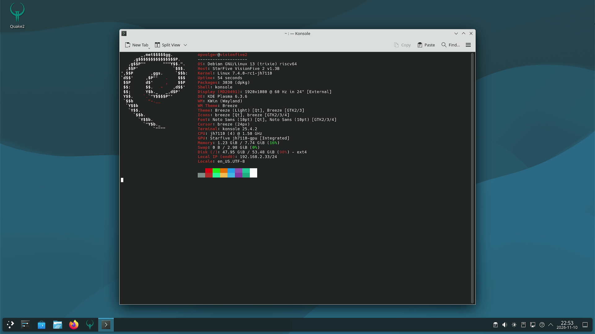

# JH7110 (VisionFive 2): accelerated HDMI on Debian 13

> **For a new Claude Code session:** read this whole file first. Check **Current status** and
> the **Progress log** (newest entry at the bottom). Continue from the first open item in the
> **Plan**. Update this file *while working* (after each step that succeeds or fails), not only
> at the end, so a session that hangs or dies loses no progress.

## Goal

1. HDMI output with GPU acceleration on the StarFive VisionFive 2 (JH7110), running Debian 13
   (trixie).
2. Half-Life 2 (one of the builds in `~/games` on the board) starts and runs on it.
3. A tested **rollback how-to**: return the board to the stock Debian 13 kernel/Mesa packages.

## Rules / working method

- Same setup as `~/code/linux-kernel-jupiter-1`: a mainline kernel plus a patch series, a
  Makefile that checks out, patches and builds `.deb` packages, with the patches kept in this
  project.
- Build on this machine (Fedora x86_64) by **cross-compiling**. If tools are missing, use a
  Docker image with a cross toolchain. **No native builds under QEMU emulation** (far too slow).
- You may install tools on the board for testing HDMI/DRM (`drm_info`, `modetest`, `kmscube`,
  `vulkaninfo`, `glmark2`, etc.).
- Every package we replace must have a documented way back to the Debian package (see
  **Rollback**).
- Keep the stock Debian kernel installed and bootable at all times (GRUB fallback entry).

## Current status

| Part | Status | Notes |
| --- | --- | --- |
| Board reachable (SSH/serial/power) | ✅ | Debian 13.7, running Debian kernel `6.12.74+deb13+1` |
| Kernel 7.4-rc1 + patches | ✅ | `7.4.0-rc1-jh7110` boots, `debs/linux-image-7.4.0-rc1-jh7110_7.4.0-rc1-1_riscv64.deb` |
| Display (DC8200 + HDMI) via DRM/KMS | ✅ | fbcon + KDE Plasma Wayland at 1920x1080@60 (llvmpipe), see `shots/phase-a-kde-fastfetch-llvmpipe.png` |
| GPU (IMG BXE-4-32, `drm/imagination`) | ✅ | FW v1.1 boots, `renderD128`; Vulkan 1.2 (`vulkaninfo`) |
| Mesa (PowerVR Vulkan + Zink) | ✅ | Mesa 26.3.0 in /opt; KDE (kwin) composites with "zink Vulkan 1.2 (PowerVR BXE-4-32)", see `shots/phase-b-kde-fastfetch-powervr.png` |
| Half-Life 2 | ✅/🔧 | ToGL build plays on Zink/PowerVR (world, viewmodel, HUD correct: `shots/phase-b-hl2-timedemo.png`); very slow; stability being tested (Mesa patch 0003) |
| Rollback how-to tested | ⏳ | |

## Plan

1. [x] Set up the project: git repo, `Makefile`, `scripts/`, `linux-7.4-patches/` (copy the
       structure of `~/code/linux-kernel-jupiter-1`).
2. [x] Kernel 7.4-rc1 (mainline) + patches for the display controller, HDMI and GPU; cross-build
       `.deb`s (a modules + initramfs flavor based on the Debian config).
3. [x] Install next to the Debian kernel, boot it, check: `/dev/dri/card*`, `modetest`, a console
       on HDMI (watch via the UGREEN capture).
4. [ ] GPU: `drm/imagination` loads and its firmware is found (`/lib/firmware/powervr/`).
5. [ ] Mesa: check whether trixie-backports is enough (PowerVR Vulkan driver for BXE-4-32,
       Zink for OpenGL). If not, cross-build Mesa `.deb`s.
6. [ ] Test: `vulkaninfo`, `kmscube`/`vkcube`, `glmark2`; then a desktop/compositor if needed.
7. [ ] Start Half-Life 2.
8. [ ] Write and **test** the rollback how-to.

## Project layout

```text
Makefile                  make checkout-7.4 / config-7.4 / deb-7.4 / export-7.4 (make help)
linux-7.4-patches/        0001-0005 HDMI PHY series v7, 0006-0024 display series v7 (from lore),
                          0025-0028 XPbmtUC errata (Samuel Holland ALTERNATIVE_3 + Bo Gan),
                          0029-0038 PowerVR BXE-4-32 bring-up (domibel, rebased on 7.4-rc1)
mesa/                     Dockerfile + build.sh: Mesa cross-build -> debs/mesa-jh7110_*.deb (/opt)
scripts/firmware-deb.sh   debs/powervr-firmware-jh7110_*.deb (pinned BXE-4-32 firmware)
configs/debian/           Debian config of the board (7.1.7 backports), base for our config
scripts/kernel-tree.sh    worktree linux-7.4/ of .kernel.git (shallow, tag v7.4-rc1) + git am
scripts/make-config.sh    Debian config -> build/7.4/obj/.config (+ display options, no debug info)
scripts/export-patches.sh commits in linux-7.4/ -> linux-7.4-patches/
board-tools/              power, serial, U-Boot catch, screenshot, set-boot.sh (boot.scr)
debs/                     built packages (not in git)
logs/                     build logs (not in git)
shots/                    HDMI captures for the documentation
```

Kernel release: `7.4.0-rc1-jh7110`; the package installs `/boot/vmlinuz-<rel>` (uncompressed
Image, `KBUILD_IMAGE=arch/riscv/boot/Image`), DTBs in `/usr/lib/linux-image-<rel>/starfive/`;
Debian's initramfs hook makes `/boot/initrd.img-<rel>`.

## Board facts (found during sessions)

- Model: `StarFive VisionFive 2 v1.3B`, DTB `/boot/jh7110-starfive-visionfive-2-v1.3b.dtb`.
- **Boot: U-Boot `bootflow scan` → `/boot.scr` on mmc 0:1 (eMMC root fs).** GRUB/EFI is installed
  but *not* used (there is no grub.cfg). `/boot.scr` is compiled from `/boot.cmd` with `mkimage`.
  Careful: at the start `/boot.cmd` said 7.1.7, but `/boot.scr` (the real one) boots
  **6.12.74+deb13+1**. Use `board-tools/set-boot.sh <release>` to switch (keeps a backup
  `/boot.scr.bak-<old>`).
- Stock boot (6.12.74) as originally in `/boot.scr`; type this in U-Boot by hand to recover:
  ```
  load mmc 0:1 ${kernel_addr_r} /boot/vmlinux-6.12.74+deb13+1-riscv64
  load mmc 0:1 ${fdt_addr_r} /usr/lib/linux-image-6.12.74+deb13+1-riscv64/starfive/jh7110-starfive-visionfive-2-v1.3b.dtb
  load mmc 0:1 ${ramdisk_addr_r} /boot/initrd.img-6.12.74+deb13+1-riscv64
  setenv bootargs 'root=/dev/mmcblk0p1 radeon.si_support=0 radeon.cik_support=0 amdgpu.si_support=1 amdgpu.cik_support=1'
  booti ${kernel_addr_r} ${ramdisk_addr_r}:${filesize} ${fdt_addr_r}
  ```
- RAM 8 GB. No AMD card in the PCIe slot anymore (only the onboard VL805 USB controller).
- SDDM is enabled (graphical.target), sessions: Plasma Wayland (`plasma`) and X11 (`plasmax11`).
  No `/etc/sddm.conf.d/` config at the start.
- Test tools installed on 2026-11-10: `libdrm-tests` (modetest), `drm-info`, `kmscube`,
  `fastfetch`, `mesa-utils`, `vulkan-tools` (remove in the rollback if wanted).
- No `/lib/firmware/powervr/` at the start.
- Kernels already in `/boot`: Debian `6.12.x`, `6.17.13`, `7.0.10+deb13`, `7.1.7+deb13`
  (installed earlier; their origin is not documented yet).
- Root filesystem: 54G, **94% full (~3.5G free)**. Watch this when installing kernels/Mesa.
- Mesa: `mesa-vulkan-drivers` / `libgl1-mesa-dri` `25.2.6-1~bpo13+1` from trixie-backports
  (trixie itself has `25.0.7-2+deb13u1`).
- `~/games` on the board: only `hl2-source`. More builds are on the build machine in
  `~/games` (`hl2-dxvk`, `hl2-wayland-pr`, ...); copy one over if needed. Port notes:
  `/home/opvolger/code/source-engine/port-to-riscv.md`.
- KDE Plasma is already installed (HL2 ran before on an AMD GPU in this board).
- The Debian `7.0.10` and `7.1.7` kernels (backports) may be removed to free space.

## Software

### Kernel

Base: mainline **7.3** (stable). The patches should apply to 7.3 with small changes.

Display patches (provided by the user): **"[PATCH v7 00/19] drm: starfive: jh7110: Enable display
subsystem"** by Michal Wilczynski, 2026-11-06.

- Thread: https://kernelthread.org/t/CGME20261106135849eucas1p242718d72fa1f38e31477210fd9ee30bc@eucas1p2.samsung.com
- lore: https://lore.kernel.org/all/20261106-jh7110-clean-send-v7-0-68f7ea9913db@samsung.com/
- **Based on v7.4-rc1**, not 7.3. Dependencies:
  - PHY series "phy: Add the StarFive JH7110 Innosilicon HDMI PHY" v7:
    https://lore.kernel.org/all/20261106-jh7110-inno-hdmi-phy-v7-0-d49368303800@samsung.com/
  - clk patch `af384d6e0573` (merged in v7.4-rc1): backport this to 7.3.
- Contents: inno-hdmi bridge refactor + fixes, DT bindings, `soc: starfive` hdmi/vout subsystem
  drivers, JH7110 HDMI bridge driver, DTS update.
- External test write-up: https://big-grey.co.uk/2026/01/26/testing-starfive-jh7110-display-controller-patches/

What 7.3 already has (checked in `~/code/linux-kernel-jupiter-1/linux-7.3-vanilla`): the
Verisilicon DC driver (`drivers/gpu/drm/verisilicon/`) and `drivers/gpu/drm/bridge/inno-hdmi.c`.

**GPU (BXE-4-32): not in mainline.** 7.3 has no `gpu@` node in `jh7110.dtsi` and no JH7110 or BXE
compatible in `drm/imagination`. The kernel docs list BXE-4-32 as unsupported, and Mesa's
`imagination` Vulkan driver does not support it either (as of 2026-11; to be verified). This
display series gives **KMS/HDMI only, no 3D acceleration**.

### GPU (phase B): leads found on 2026-11-10 (research by a subagent, still to verify)

- **domibel (Dominique Belhachemi)** got the BXE-4-32 running on mainline drm/imagination:
  guide https://github.com/domibel/visionfive2_gpu_bringup ; kernel https://github.com/domibel/linux
  - branch `powervr_on_jh7110_visionfive2_v7.3-rc5` (11 commits on v7.3-rc5): GPU node in
    jh7110.dtsi (`starfive,jh7110-gpu`, `img,img-bxe-4-32`, `dma-noncoherent`), extra
    clocks/reset, `pvr_check_gpu_supported()` hack, Icenowy's "power up rascal+dust via
    RGX_CR_POWER_EVENT" and fixes for firmware teardown and the VM.
  - branch `jh7110_dc8200_hdmi_v7.3-rc5`: display series + **Bo Gan's XPbmtUC** RISC-V errata
    series (uncached mappings via emulated Svpbmt, needed on the non-coherent JH7110), lore
    `20260316060328.1173634-1-ganboing@gmail.com`, plus Samuel Holland's ALTERNATIVE_3.
  - "sifive_ccache: Add StarFive JH7110 SoC support" (domibel): reportedly already in mainline.
  - Config hints: `DRM_POWERVR=m`, `STARFIVE_STARLINK_CACHE=y`, `RISCV_NONSTANDARD_CACHE_OPS=y`,
    the SiFive errata options, `cma=128M` or more.
- Firmware `powervr/rogue_36.50.54.182_v1.fw` is not in linux-firmware; get it from
  https://gitlab.freedesktop.org/imagination/linux-firmware/-/raw/powervr/powervr/rogue_36.50.54.182_v1.fw
- Mesa **26.3** (pvr Vulkan + Zink): Vulkan 1.2, Zink OpenGL 3.2 core / GLES 3.1. Environment:
  `PVR_I_WANT_A_BROKEN_VULKAN_DRIVER=1 MESA_VK_DEVICE_SELECT=1010:36054182`. Debian 13 /
  backports (25.2) is too old, so we need to build Mesa ourselves.
- Vendor fallback (phase C): starfive-tech/linux `JH7110_VisionFive2_6.6.y_devel` / `6.12.y_devel`;
  blobs in github.com/starfive-tech/soft_3rdpart `IMG_GPU/out/img-gpu-powervr-bin-1.19.*.tar.gz`
  (GLES/Vulkan, probably **no desktop GL**, so HL2 would be hard).
- Other operating systems (FreeBSD, Haiku, ...): nothing found for this GPU.

### Mesa

First try Debian 13 backports (already installed: 25.2.6). Only build Mesa ourselves if
backports lacks support for the JH7110 GPU.

### Other software

Anything else that is needed (firmware, DTB, tools) gets the same patch-and-package setup.

## Controlling the hardware

### Power on/off

Home Assistant; the token is in `/home/opvolger/home-assistant.txt` (do not copy it into this
file or into git).

```bash
TOKEN=$(cat /home/opvolger/home-assistant.txt)
URL=http://192.168.2.202:8123/api/services/switch
curl -X POST -H "Authorization: Bearer $TOKEN" -H "Content-Type: application/json" \
  -d '{"entity_id":"switch.zolder_sonoff_plug_1"}' $URL/turn_on     # or turn_off / toggle
```

### SSH

`ssh opvolger@192.168.2.33`: no password, passwordless `sudo`. You may install kernels, Mesa and
other packages yourself as needed for the goal.

### Serial console (U-Boot and Linux console)

`/dev/ttyUSB0`, 115200 baud. U-Boot commands can be entered here.

### TFTP (network boot from U-Boot)

A TFTP server runs in Docker on this machine (container `tftp`). If it has crashed, you may
restart it:

```bash
docker run -d --name tftp --network host -v $(pwd):/var/tftpboot pghalliday/tftp
```

Useful when a kernel hangs completely: boot a test kernel over the network from U-Boot without
touching the eMMC.

### Helper scripts (`board-tools/`, copied from the jupiter project)

- `board-tools/power.sh on|off|toggle|state`: shut down cleanly first (`ssh ... sudo poweroff`).
- `python3 -I board-tools/catch.py ' ' 60`: run it right after a reboot; it spams keys and stops
  U-Boot autoboot (prompt `StarFive #`).
- `python3 -I board-tools/ser.py <secs> 'cmd1' 'cmd2'`: send commands, e.g. `'boot'`.
- `board-tools/screenshot.sh shots/x.png`: grab an HDMI frame.

Verified 2026-11-10: power state ✅, HDMI capture ✅ (`/dev/video2`, UGREEN), reboot + U-Boot
interrupt ✅ (U-Boot 2025.07-rc3, `bootcmd=bootflow scan`), `dhcp` in U-Boot ✅, `boot` back to
Linux ✅. TFTP ✅ after the user ran `sudo firewall-cmd --add-service=tftp`. This is **deliberately not
permanent** (the user opens it per session for safety on other networks). If TFTP times out at
`Loading:`, ask the user to run that command again. Do not suggest `--permanent`. Build machine
IP: `192.168.2.34`. In U-Boot: `dhcp` sets `serverip` to the router (.254), so run
`setenv serverip 192.168.2.34` **after** `dhcp`; send U-Boot commands one per `ser.py` call
(they get garbled when sent while `dhcp` is still running). Example load: `tftpboot 0x44000000 <file>`.

**Power cycle:** a powerstation sits behind the plug and buffers power. After `poweroff`, **5 s off
is not enough** (the board stays dead). **60 s off works.** Do: `ssh ... sudo poweroff`, wait about
20 s, `power.sh off`, wait 60 s, `power.sh on`. Don't `pkill -f` with a pattern that matches your
own shell command.

### Watching the HDMI output (UGREEN capture)

An HDMI capture device is connected to this machine (`/dev/video*`; which node is still to be
`/dev/video2` "UGREEN HDMI Capture"; the script looks it up by name). Grab a frame to see what the board shows on HDMI.

## Phase A result: KDE on HDMI without GPU (2026-11-10 21:47) ✅


Changes on the board needed for the KDE session (all in their own files, delete to undo):

- `/etc/sddm.conf.d/50-jh7110.conf`: `GreeterEnvironment=QT_QUICK_BACKEND=software` (the SDDM
  greeter `sddm-greeter-qt6` crashes with SIGSEGV in `QSGRenderThread` on llvmpipe; it also did that
  on 7 Nov, before this project) plus `[Autologin] User=opvolger Session=plasma` (Wayland).
- `~/.config/plasma-workspace/env/jh7110-kwin.sh`: `export KWIN_DRM_NO_AMS=1`. With atomic
  modesetting kwin's TEST_ONLY commit fails with EINVAL ("Atomic modeset test failed! Invalid
  argument"), and with drm.debug=0x16 nothing is logged: the state gets connector 42 + CRTC 40 + CRTC
  50 and is then cleared without `atomic_check`, so a property is rejected while being set. With
  legacy KMS it works. Root cause still to find (verisilicon driver; candidate: a CRTC/plane
  property kwin sets).
- `~/.config/autostart/jh7110-fastfetch.desktop`: Konsole with fastfetch (for the screenshot).
- Small green specks are scattered on the screen: probably cache lines of the non-coherent
  framebuffer (see the dri-devel thread "drm: verisilicon: support non-coherent DMA framebuffers").
- Other boot remarks on 7.4: `end1` (2nd ethernet) "Failed to reset the dma" (unused port);
  `CCACHE: DataError` once at boot; `i2c i2c-7: of_i2c: modalias failure ... controller/ports`
  (harmless, the DDC bus works: EDID is read).

## Phase B result: KDE on the PowerVR GPU (2026-11-10 22:53) ✅



kwin: `OpenGL renderer string: zink Vulkan 1.2(PowerVR B-Series BXE-4-32 MC1 (IMAGINATION_OPEN_SOURCE_MESA))`,
`OpenGL version string: 3.2 (Core Profile) Mesa 26.3.0` (`qdbus6 org.kde.KWin /KWin supportInformation`).
The green specks of the llvmpipe/dumb-buffer setup are gone.

How the rendering is wired (important for later sessions):

- The DRM card numbers change per boot (powervr vs verisilicon load order). Always use
  `/dev/dri/by-path/platform-29400000.display-card` (DC8200) and
  `/dev/dri/by-path/platform-18000000.gpu-{card,render}` (PowerVR).
- kwin only uses the display card (`KWIN_DRM_DEVICES=<display-card>`); kwin ignores the PowerVR
  card (no KMS outputs). EGL/GBM on the display card loads driver name `verisilicon` →
  `/opt/mesa-jh7110/lib/dri/verisilicon_dri.so` (symlink to libdril_dri.so) → gallium has no
  `verisilicon` driver → **kmsro** fallback → **Zink renderonly** on the PowerVR Vulkan device,
  scanout buffers are dumb (CMA) buffers on the display card.
- `MESA_LOADER_DRIVER_OVERRIDE=zink` must **not** be set for kwin (then Zink opens the display
  card directly, finds no Vulkan device for it and falls back to softpipe).
- `kwin_wayland` has file capability `cap_sys_nice=ep` → glibc secure mode → `LD_LIBRARY_PATH`
  ignored → Debian libgbm + our backend → "libgallium-26.3.0.so: cannot open". Removed with
  `sudo setcap -r /usr/bin/kwin_wayland` (undo: `sudo dpkg-reconfigure kwin-wayland`).
  `libcap2-bin` was installed for getcap/setcap.
- Session environment: `~/.config/plasma-workspace/env/jh7110-mesa.sh`:
  ```sh
  . /opt/mesa-jh7110/env.sh
  unset MESA_LOADER_DRIVER_OVERRIDE
  export KWIN_DRM_DEVICES=/dev/dri/by-path/platform-29400000.display-card
  ```
  plus `jh7110-kwin.sh` (`KWIN_DRM_NO_AMS=1`, still needed).
- Firmware deb rev 2 has an initramfs hook (powervr probes from the initramfs at ~8 s).

## Rollback to stock Debian 13

Debian's own Mesa packages (trixie-backports 25.2.6) were **never replaced**: our Mesa lives in
`/opt/mesa-jh7110` and is only used where `/opt/mesa-jh7110/env.sh` is sourced. So the rollback is:
the stock kernel back in `/boot.scr`, our three packages purged, and our config files removed.

**Script:** `board-tools/rollback.sh` (dry run; `board-tools/rollback.sh --yes` executes it), then
`ssh opvolger@192.168.2.33 sudo systemctl reboot` and check `uname -r` = `6.12.74+deb13+1-riscv64`.

Everything the project changed on the board, and how to undo it by hand:

| Change | Undo |
| --- | --- |
| `/boot.scr` boots `7.4.0-rc1-jh7110` (written by `board-tools/set-boot.sh`) | `sudo cp /boot.scr.bak-6.12.74+deb13+1-riscv64 /boot.scr` (the original boot.scr), or `board-tools/set-boot.sh 6.12.74+deb13+1-riscv64` |
| `/boot.cmd` overwritten (originally it pointed to 7.1.7, it was not what `boot.scr` contained) | the original text is in `board-tools/rollback.sh` |
| package `linux-image-7.4.0-rc1-jh7110` | `sudo apt-get purge linux-image-7.4.0-rc1-jh7110` |
| package `powervr-firmware-jh7110` (+ initramfs hook; initramfs of all kernels rebuilt) | `sudo apt-get purge powervr-firmware-jh7110` (postrm rebuilds the initramfs again) |
| package `mesa-jh7110` (`/opt/mesa-jh7110`, `/usr/local/bin/mesa-jh7110-run`) | `sudo apt-get purge mesa-jh7110` |
| `/etc/sddm.conf.d/50-jh7110.conf` (software greeter + autologin Plasma Wayland) | `sudo rm /etc/sddm.conf.d/50-jh7110.conf` |
| `/etc/sysctl.d/50-jh7110-printk.conf` (`kernel.printk = 4 4 1 7`) | `sudo rm /etc/sysctl.d/50-jh7110-printk.conf` |
| `~/.config/plasma-workspace/env/jh7110-kwin.sh`, `jh7110-mesa.sh` | `rm` them |
| `~/.config/autostart/jh7110-fastfetch.desktop` | `rm` it |
| `kwin_wayland` file capability `cap_sys_nice` removed | `sudo dpkg-reconfigure kwin-wayland` |
| test tools installed: `libdrm-tests drm-info kmscube fastfetch mesa-utils vulkan-tools libcap2-bin` | optional: `sudo apt-get purge ...` |
| `~/games/hl2-source-togl/` (ToGL build, data symlinked to `~/games/hl2-source`), `~/hl2-*.log`, `~/hl2-gdb.cmd` | optional: `rm -r` |

Untouched: Debian kernels (6.12.x, 6.17, 7.0, 7.1 are still installed), Debian Mesa, U-Boot, GRUB/EFI.

Rollback **tested**: not yet (see Plan step 8).

## Open questions

(none open)

## Decisions (user, 2026-11-10)

1. Kernel base: **7.4-rc1** is fine (instead of 7.3).
2. Phase A: KDE Plasma on HDMI with display-only (llvmpipe). Take screenshots with a terminal
   running `fastfetch` for the documentation.
3. Phase B: look for out-of-tree BXE-4-32 GPU work (Linux, maybe also FreeBSD/Haiku, etc.) and
   try it. **Do not start HL2 in this phase.**
4. Phase C: if B really does not work, use the StarFive vendor kernel 6.6 + their Mesa/GPU
   packages to get HL2 running (still with a rollback how-to).
5. The user leaves the machine; work autonomously.


## Progress log

Newest entry at the bottom. Per entry: date, what was tried, result (✅/❌), where logs are.

- **2026-11-10**: Document restructured and translated to English. Board inventory taken (see
  *Board facts*). Nothing built yet.
- **2026-11-10**: git repo created. Display patch series identified (v7, base 7.4-rc1, needs
  PHY series + clk backport). Found that the BXE-4-32 GPU has no mainline kernel/Mesa support.
- **2026-11-11 00:30**: Timedemo `bench` (5449 frames, 1280x720) with Mesa rev 4: renders correctly
  (the black first picture was just a dark spot), but very slow (main thread ~92% CPU; 4x U74) and
  after ~15 min **SIGSEGV** in `pvr_rogue_mrt_load_op_state_cleanup` ← `pvr_dynamic_render_info_destroy`
  ← `pvr_cmd_buffer_reset` (Zink submit thread). Cause: when a dynamic render is split into several
  gfx sub-commands, they all copy the same `dr_info`/`rstate` pointers and each frees them → double
  free. Fix `mesa/patches-26.3.0/0003-pvr-free-shared-dr-info-once.patch` (before freeing, walk the
  sub-command list backwards and NULL out pointers already owned by a later sub-command). Mesa rev 5.
  Also: the audio DMA (dw_axi_dmac) prints "apb_regs not initialized" for every transfer → the serial
  console thread `pr/ttyS0` used 30-40% CPU. Fix: `/etc/sysctl.d/50-jh7110-printk.conf`
  (`kernel.printk = 4 4 1 7`; remove to undo). Better later: a kernel patch (dev_warn_once).
- **2026-11-10 23:48**: ✅ **HL2 in-game on the GPU** (`shots/phase-b-hl2-ingame-first.png`). Root cause
  of the hang: `strace -f -Z -e trace=ioctl` → `DRM_IOCTL_PVR_CREATE_HWRT_DATASET = -1 ENOSPC`. The
  kernel's `pvr_fw_object_create()` runs out of the **16 MB MIPS firmware heap**
  (`ROGUE_FW_HEAP_MIPS_SHIFT 24`): with dynamic rendering (used by Zink) Mesa's pvr driver creates a
  new HWRT dataset (+ its own local free list, both FW objects) for **every vkCmdBeginRendering**, kept
  until the command buffer is reset. HL2 loading does hundreds of small blits per command buffer.
  Fix: `mesa/patches-26.3.0/0002-pvr-share-rt-datasets.patch`: device-level cache of RT datasets keyed
  on (width, height, samples, layers); cached datasets are only destroyed at device destroy (the
  framebuffer path already shares one dataset between many renders, so sharing is safe).
  Mesa rev 4 (`debs/mesa-jh7110_26.3.0-4_riscv64.deb`) installed.
- **2026-11-10 23:35**: Debugging the HL2/ToGL failure (Mesa debug variant:
  `BUILDTYPE=debug PKGREV=3 mesa/build.sh` → `debs/mesa-jh7110_26.3.0-3~dbg_riscv64.deb`, with
  temporary PVRDBG logging in pvr_cmd_buffer.h/pvr_arch_pipeline.c; sources restored afterwards).
  gdb (`~/hl2-gdb.cmd` on the board: `break mesa_log if level == 0 && ($_memeq(format,"PVRDBG",6) ||
  $_memeq(format,"ZINK",4))`) shows: the error is set in `pvr_rogue_cmd_buffer_end_sub_cmd`
  (pvr_arch_cmd_buffer.c:2568, after `pvr_sub_cmd_gfx_job_init` fails) from `CmdEndRendering` of a
  u_blitter blit (32x32, texelFetch) for ToGL's `glGetTexImage` (`GLMContext::GenDebugFontTex`).
  Candidate: `pvr_render_targets_dataset_init()` (HWRT dataset / free list ioctl). **After such a
  failure the GPU hangs for every client (kwin too) without any kernel message → reboot needed.**
  Also seen: `verisilicon-dc: swiotlb buffer is full` (DC8200 has a 32-bit DMA mask, imported buffers
  above 4 GB get bounced; to look at later).
- **2026-11-10 23:05**: HL2. `~/games/hl2-source` on the board is the **DXVK** build (DXVK 3.1.1):
  "Skipping: Device does not support Vulkan 1.3" → `DxvkError` ❌ (PowerVR is Vulkan 1.2). Deployed the
  **ToGL** build (`~/code/source-engine/install-riscv64`, sha256 checked) to `~/games/hl2-source-togl`
  (game data symlinked to `~/games/hl2-source/hl2`, own cfg/save). Start (systemd user unit, see
  source-engine notes) with `. /opt/mesa-jh7110/env.sh; SDL_VIDEODRIVER=wayland`. Log: "OpenGL: zink
  Vulkan 1.2(PowerVR B-Series BXE-4-32 MC1) 3.2 (Compatibility Profile) Mesa 26.3.0"; window "HALF-LIFE 2
  - OpenGL" shows the loading screen, then `MESA: error: ZINK: vkEndCommandBuffer failed
  (VK_ERROR_INITIALIZATION_FAILED)` right after loading engine.so and it hangs at "Loading..."
  (`shots/hl2-togl-loading-zink.png`). No kernel messages. Probably a pipeline/shader the PowerVR driver
  can't build (errors in draw-time pipeline creation are recorded silently in the cmd buffer).
  Also: the UGREEN capture returns a **stale first frame** → screenshot.sh now keeps the 15th frame.
  Note: the board also runs k0s/etcd (not ours; uses ~30% CPU).
- **2026-11-10 22:53**: ✅ **KDE Plasma composited on the PowerVR GPU** (Zink via kmsro). Steps that
  failed first: `KWIN_DRM_DEVICES=card1:card0` (card numbers swap per boot; kwin ignores the
  non-KMS powervr card), kwin cap_sys_nice → LD_LIBRARY_PATH ignored, `MESA_LOADER_DRIVER_OVERRIDE=zink`
  → softpipe. Working: verisilicon_dri.so → kmsro → zink renderonly (see *Phase B result*).
  Restarting sddm while the old session is still shutting down leaves no session: reboot instead.
- **2026-11-10 22:30**: ✅ **GPU works.** Kernel 7.4.0-rc1-2 boots with `Using XPbmtUC bit 32`.
  powervr probes from the initramfs *before* the root fs is there → firmware -2. After
  `modprobe -r powervr; modprobe powervr`: "loaded firmware powervr/rogue_36.50.54.182_v1.fw, FW
  version v1.1 (build 6976702 OS)", "Initialized powervr 1.0.0 ... minor 1", `/dev/dri/renderD128`.
  With `. /opt/mesa-jh7110/env.sh`: `vulkaninfo` → GPU0 "PowerVR B-Series BXE-4-32 MC1", apiVersion
  1.2.363, Mesa 26.3.0; `eglinfo -B` GBM → "zink Vulkan 1.2(PowerVR B-Series BXE-4-32 MC1)", OpenGL
  3.2 core + 3.2 compat, GLES 3.1. Wayland platform still softpipe (kwin runs on Debian Mesa).
  Build fix needed: in 7.4 `riscv_alternative_fix_offsets()` got an `early` argument → `false` in
  the sifive errata path (folded into patch 0027).
- **2026-11-10 21:55**: Phase B started. Cherry-picked from github.com/domibel/linux onto 7.4-rc1:
  Samuel Holland's ALTERNATIVE_3 (conflict: 7.4 dropped the !CONFIG_RISCV_ALTERNATIVE branch →
  keep only the real define), "auipc+load pair" (conflict: 7.4 added an `early` arg → kept),
  Bo Gan's XPbmtUC errata (conflict with the new `mal-9092` sifive erratum → both kept: MAL_9092=2,
  XPBMTUC=3, NUMBER=4), then 10 of domibel's 12 GPU commits. Skipped: the vout clk patch (already
  in 7.4-rc1 as af384d6e0573) and 2 pvr_vm remap fixes (already fixed upstream in 7.4). Config:
  `DRM_POWERVR=m ERRATA_SIFIVE_XPBMTUC=y STARFIVE_STARLINK_CACHE=y RISCV_NONSTANDARD_CACHE_OPS=y`.
  Firmware deb + Mesa 26.3 (/opt) installed on the board.
- **2026-11-10 21:47**: ✅ **Phase A done.** 7.4.0-rc1-jh7110 boots via `/boot.scr`; DRM
  `verisilicon` card0, HDMI-A-1 connected, EDID read, fbcon visible. SDDM greeter crashed → software
  Qt Quick + autologin. kwin_wayland: atomic test fails (EINVAL) → `KWIN_DRM_NO_AMS=1` → Plasma
  Wayland + Konsole/fastfetch on HDMI (screenshot). Meanwhile Mesa 26.3.0 cross-built in docker
  (`mesa/Dockerfile`, `mesa/build.sh`): needed a wayland-scanner 1.24 wrapper (reports 1.23.1, drops
  `--strict`) because the wayland-protocols 1.49 subproject uses the new `frozen` attribute.
- **2026-11-10 21:30**: user decided: base 7.4-rc1 (so no clk backport needed). Downloaded the PHY
  (5) and display (19) series from lore (plain curl works; a browser UA gets an Anubis bot page).
  All 24 apply cleanly on v7.4-rc1 ✅. Config from Debian 7.1.7 config + display options ✅.
  Found the board really boots via `/boot.scr` (not GRUB). First `make deb-7.4` started.
  Review remarks on the series (sashiko AI bot) worth remembering if something breaks: HPD irq
  race in inno-hdmi after probe split; hdmi-subsystem regmap uses val_bits 8/stride 1 while the
  children do 32-bit accesses at offset*4; DT CMA alloc-ranges breaks 1 GiB boards (ours: 8 GB).
